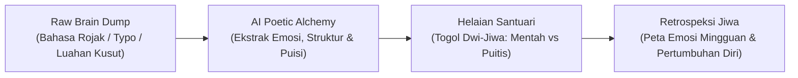

# Pelan Induk Penyelidikan Produk & Reka Bentuk UX: "Dear Diary" 📖✨
> *Kajian Mendalam End-to-End: Dari Psikologi Luahan Jiwa Sehingga Seni Bina Antaramuka Bertaraf Dunia (iOS & Android).*

---

## 1. Executive Summary & Problem Space (Kajian Masalah)

### Mengapa 80% Pengguna Berhenti Menulis Diari Selepas 7 Hari?
Berdasarkan kajian UX ke atas aplikasi jurnal sedia ada (*Day One, Reflectly, Rosebud, Apple Journal*), terdapat 3 halangan psikologi utama:

1. **"The Blank Page Paralysis" (Sindrom Halaman Kosong):**
   Pengguna membuka aplikasi pada waktu malam semasa penat, melihat kursor berkelip di atas skrin putih, berasa buntu mahu mula dari mana, lalu menutup aplikasi.
2. **"The Polishing Burden" (Beban Mengarang):**
   Pengguna mahukan diari yang sedap dibaca bila diselak 5 tahun akan datang, tetapi malas/tidak bertenaga untuk menyusun tatabahasa, memilih kosa kata berbunga, atau membetulkan ejaan.
3. **"Lack of Catharsis & Feedback Loop":**
   Menulis diari tradisional adalah jalan sehala. Tiada respon empati yang membuatkan pengguna merasa "didengari" (*unheard*).

### Nilai Unik "Dear Diary" (*The Core Value Proposition*):
> **"Tumpahkan sahaja kekusutan fikiran anda (dalam bahasa rojak, perkataan berselerak, tanpa tatabahasa), dan saksikan bagaimana AI menganyamnya menjadi sebuah karya sastera yang menyentuh hati — tanpa mengubah 1% pun keaslian perasaan anda."**



---

## 2. Pemetaan Persona Pengguna (User Personas)

| Atribut | Persona A: "The Overwhelmed Soul" (Sarah, 27) | Persona B: "The Fragmented Thinker" (Hafiz, 22) |
| :--- | :--- | :--- |
| **Konteks Hidup** | Eksekutif muda, stres kerja, overthinking pada waktu malam. | Pelajar universiti, banyak idea kreatif tetapi fikiran berserabut. |
| **Tabiat Menulis** | Tulis bila ada masalah besar, guna bahasa rojak (*"wehh penat gila today..."*). | Guna nota suara pendek (*voice notes*) semasa memandu atau jalan kaki. |
| **Matlamat Utama** | Pelepasan emosi (*catharsis*), mahu merasa tenang sebelum tidur. | Mendokumentasikan perjalanan hidup untuk rujukan masa hadapan. |
| **Halangan Terbesar** | Malu bila baca balik tulisan sendiri yang nampak canggung. | Malas taip panjang-panjang di papan kekunci telefon. |
| **Penyelesaian App** | AI Alchemy menukar keluhan jadi hikmah & ketenangan. | Voice-to-Text empathic orb + penukaran suara ke prosa puitis. |

---

## 3. End-to-End User Journey (Aliran Penuh Dari Mula Ke Akhir)

Aliran hidup pengguna dibahagikan kepada 5 fasa utama:

```mermaid
journey
    title Perjalanan Harian Pengguna Dear Diary
    section Fasa 1: Gerbang Selamat
      Buka Aplikasi : 5: Tenang
      Imbasan Face ID : 5: Selamat & Peribadi
    section Fasa 2: Luahan Emosi
      Pilih Mood Hati : 4: Bersahaja
      Taip / Rakam Celoteh Bebas : 5: Bebas tanpa sekatan
    section Fasa 3: Transformasi AI
      Tekan 'Sulap Jadi Puisi' : 4: Teruja
      Efek Cahaya Shimmer : 5: Kagum
      Terima Hasil Puitis : 5: Menyentuh Hati
    section Fasa 4: Perbandingan
      Togol Mentah vs Puitis : 5: Memuaskan
      Simpan ke Arkib : 5: Lega
    section Fasa 5: Retrospeksi
      Selak Muka Surat 3D : 5: Nostalgia
      Lihat Graf Kesejahteraan Mingguan : 4: Reflektif
```

---

### Fasa 1: Onboarding & Sanctuary Entry (Pintu Gerbang & Keselamatan)
Bukan borang pendaftaran yang panjang. Onboarding mestilah satu sesi bertenang (*zen ritual*):
1. **The Safe Space Pledge:** Menjelaskan bahawa ini adalah ruang peribadi yang disulitkan (*on-device encryption / private storage*).
2. **Setup Biometrik Segera (Apple Face ID / Touch ID):** Kunci aplikasi terus diaktifkan supaya tiada sesiapa boleh membaca luahan intim pengguna.
3. **The 60-Second "Aha!" Moment:** Pengguna tidak dibiarkan meneroka sendiri; mereka diberi peluang menaip 1 ayat mentah terus di skrin onboarding, menekan butang AI, dan merasai keajaiban transformasi dalam masa 10 saat pertama.

---

### Fasa 2: The Daily Dump Ritual (Kanvas Luahan Mentah)
Reka bentuk antaramuka semasa menulis mesti menghapuskan sebarang gangguan visual (*zero chrome*):
1. **Mood Weather Dial (Pemilihan Emosi Awal):**
   - Bukan sekadar ikon senyum/sedih biasa.
   - Pilihan emosi nuansa: *🌅 Syukur, 🌧️ Gundah, 🔥 Kusut, ✨ Teruja, 🌙 Sunyi, 🍃 Hampa*.
2. **Dual-Input Modality:**
   - **Teks Bebas:** Ruang tanpa had baris. Matikan garisan merah penyemak ejaan (*spellcheck auto-correct*) agar pengguna tidak terganggu bila guna bahasa slanga atau rojak.
   - **Voice Dump (The Empathic Orb):** Rakam luahan suara. Menggunakan visualisasi bebola cecair organik yang bernafas mengikut intonasi suara pengguna, kemudian ditranskripsi ke teks secara automatik.
3. **Mikro-Prompt Pilihan (Bila Buntu):**
   - Pagi: *"Apa satu perkara kecil yang menceriakan harimu?"*
   - Malam: *"Apakah beban yang ingin kamu lepaskan malam ini sebelum lelap?"*

---

### Fasa 3: The Poetic Alchemy (Seni Transformasi AI)
Transformasi bukan sekadar 'loading spinner' biasa. Ia adalah detik magis:
1. **Pilihan Nada Puitis (Voice & Tone Selector):**
   - *Sastera Klasik Melankolik* (Gaya Usman Awang / Rumi - mendalam & menyentuh rasa).
   - *Ketenangan Stoik & Reflektif* (Menenangkan, mencari hikmah di sebalik kekusutan).
   - *Sinar Harapan & Semangat* (Memberi sokongan moral dan kehangatan).
2. **Koreografi Animasi (Motion Design):**
   - Gelombang kilauan (*ambient shimmer*) menyapu skrin dari bawah ke atas.
   - Haptic feedback yang berirama lembut (*Taptic pulse*).
   - Teks puitis muncul baris demi baris seperti dakwat yang mekar di atas kertas basah.

---

### Fasa 4: The Comparison & Preservation (Perbandingan & Simpan)
1. **Mekanisme Togol Interaktif:**
   - Togol kemas: `[ ✍️ Mentah ] | [ ✨ Puitis ]`.
   - Menggunakan animasi *cross-fade morph* yang lancar.
2. **Storan Dwi-Format:** Setiap entri menyimpan **kedua-dua versi** di dalam pangkalan data. Pengguna boleh membaca semula celoteh raw mereka 10 tahun akan datang, di samping menikmati versi cantiknya.
3. **Tagging & Cuaca Automatik:** Tarikh, masa, hari, dan lokasi/cuaca semasa direkodkan secara halus pada bahagian atas kad.

---

### Fasa 5: The Sanctuary Timeline & Retrospect (Menyelak Kenangan)
1. **Animasi Selak Muka Surat (3D Page Flip):**
   - Diari bukan sekadar senarai skrol Instagram. 
   - Ia mempunyai mod selak helaian (*physics curl*) seolah-olah menyelak buku jurnal fizikal.
2. **Kalendar & Kapsul Emosi Mingguan (*Weekly Soul Digest*):**
   - Peta haba emosi (*Mood Heatmap*) yang menunjukkan corak perasaan pengguna sepanjang bulan.
   - AI membuat rumusan mingguan: *"Minggu ini anda banyak berdepan tekanan kerja pada hari Selasa & Rabu, tetapi anda menemui ketenangan pada hujung minggu."*
3. **Fungsi Carian Menyeluruh (Deep Search):**
   - Boleh cari mengikut kata kunci emosi, tarikh, atau kenangan tertentu (*cth: "kopi", "hujan", "boss"*).

---

## 4. Seni Bina Maklumat (Information Architecture)

```text
Dear Diary App (Root)
│
├── 1. Tab Santuari (Home Timeline)
│   ├── Bar Status & Sapaan Waktu (Apple HIG Large Title)
│   ├── Aura Cahaya Latar Belakang (Dynamic Mood Ambient Glow)
│   ├── Peta Haba Emosi Ringkas (Weekly Mood Strip)
│   ├── Senarai Helaian Kad Diari (Card Feed with Staggered Shadow)
│   └── Bar Terapung Tindakan Kaca (Floating Vellum Bar: Tulis & Suara)
│
├── 2. Skrin Tulis Luahan (Composer Modal)
│   ├── Pemilih Emosi (Mood Pill Wheel)
│   ├── Kanvas Mentah (Raw Freeform TextArea)
│   ├── Rakaman Suara Berempati (Empathic Voice Orb)
│   ├── Enjin Alchemy AI (Pilihan Gaya Puitis)
│   └── Togol Perbandingan Segera (Raw vs Poetic Switch)
│
├── 3. Tab Arkib & Retrospeksi (Reflections & Search)
│   ├── Paparan Kalendar Penuh & Mood Heatmap
│   ├── Kapsul Mingguan/Bulanan (AI Soul Digest)
│   └── Bar Carian Pintar (Search by Mood, Date, Keyword)
│
└── 4. Tab Tetapan Jiwa (Settings & Sanctuary Security)
    ├── Kunci Biometrik (Face ID / Passcode)
    ├── Sandaran Data & Privasi (iCloud / Local SQLite Export)
    ├── Eksport ke Buku Fizikal (PDF Printable Book Layout)
    └── Pilihan Tema & Fon (Parchment Tone / Font Pairings)
```

---

## 5. Pelan Tindakan Pembangunan (Development Roadmap)

Berikut adalah pelan fasa demi fasa untuk membina aplikasi ini secara teratur:

- [x] **Fasa 1: Asas Projek & Repositori**
  - Setup Git & GitHub, integrasi Apple HIG, pelancaran Expo SDK 58, dan prototaip interaktif pertama.
- [ ] **Fasa 2: Sistem Visual & Seni Bina Komponen (Deep UI)**
  - Menggantikan ikon sementara dengan **Apple SF Symbols / Lucide Native Icons**.
  - Menetapkan fon rasmi (*Newsreader Serif* untuk versi puitis, *Plus Jakarta Sans* untuk versi mentah).
  - Menambah tekstur kertas mikro (*subtle canvas grain*).
- [ ] **Fasa 3: Enjin AI Sebenar (Real AI Alchemy Engine)**
  - Menghubungkan API AI (seperti Gemini Flash API) dengan *prompt engineering* puitis yang diselaraskan untuk bahasa rojak Malaysia / Nusantara.
  - Menambah efek teks menaip secara langsung (*streaming typewriter effect*).
- [ ] **Fasa 4: Rakaman Suara & Transkripsi Audio (Voice-to-Text)**
  - Pemasangan modul audio Expo (`expo-audio` / `expo-speech-recognition`).
  - Animasi bebola audio cecair (*fluid soundwave orb*).
- [ ] **Fasa 5: Pangkalan Data Tempatan (Offline-First SQLite)**
  - Menyimpan catatan secara kekal dalam storan tempatan telefon pengguna (cepat, selamat, tiada risiko kebocoran data).
- [ ] **Fasa 6: Keselamatan Biometrik (Face ID / Local Authentication)**
  - Integrasi `expo-local-authentication` untuk perlindungan privasi maksimum.
